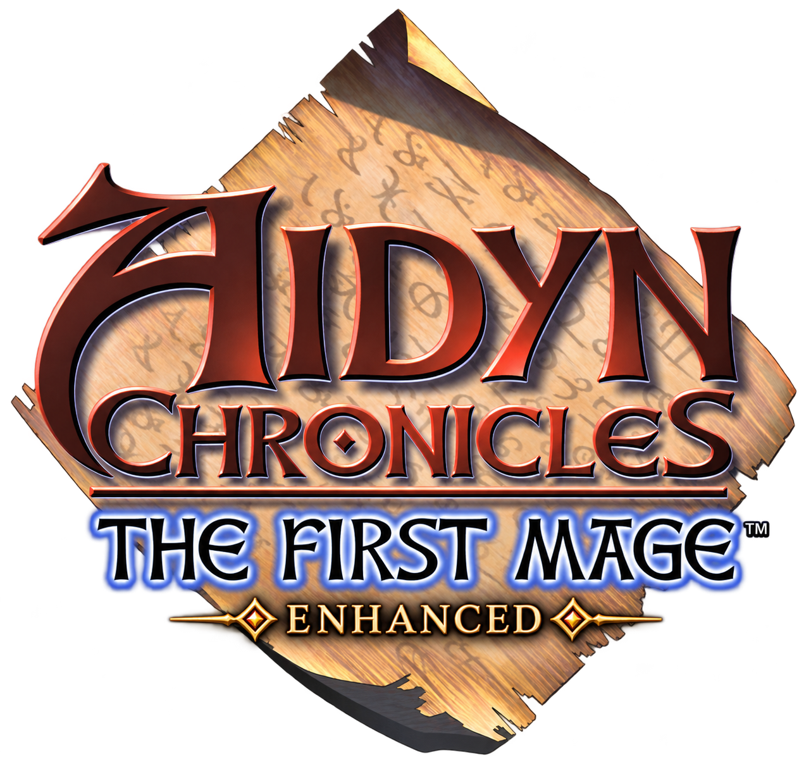

# Aidyn Chronicles Enhanced

A PC port of the engine that runs Aidyn Chronicles: The First Mage for the
Nintendo 64, written in C# and Godot. It is a fork of
[HBHT](https://github.com/Aquatakat/hbht), continued under its own name; see
[Provenance](#provenance).

The goal is a largely console-accurate version of the game, with a set of
optional enhancements, and a comprehensive mod editor, similar to something
like OpenMW-CS.

No game content is included. You must bring your own copy of the US 1.0 ROM.
A ROM hack of 1.0 that edits only the game's data, such as its stats, items and
shops, imports too: the Action Edition is one
([ADR 0031](docs/adr/0031-a-data-edit-of-1.0-imports.md)).
Not affiliated with H2O Entertainment or THQ; Aidyn Chronicles is their
trademark.

## Getting started

1. Download the latest release
2. Run `aidyn-enhanced` or `aidyn-enhanced.exe`
3. On first run, select your ROM, and decide whether or not you want to fix the
   mushroom (you know the one)
4. Play

To build from source, install the .NET 10 SDK that `global.json` pins and run
`dotnet test` from the repository root. `aidyn-enhanced import <rom>` imports the
ROM, and `tools/godot.ps1 --path src/AidynEnhanced.Game` runs the game on it.
[CLAUDE.md](CLAUDE.md) maps the code, the formats, the systems and the docs.

## Accuracy

This project is not a decompilation. It is a clean-room reimplementation of the
engine in a different language, with the ROM's machine code read to answer
specific questions about how certain systems function. This gains a lot of
flexibility and the ability to expand the game in the future, but loses
flawless accuracy and requires significantly more testing.

The primary goal is a reasonable representation of the game, down to some of
its weirder quirks, but this is a game limited by its hardware and rushed out
the door, so some bugs and limitations are corrected at the expense of perfect
N64 accuracy.

Timing is a big one. A lot of effects in the game (weather, animated textures,
some RNG) are directly tied to framerate, so the speed could vary. On a modern
computer, this isn't as much of an issue, but in order to get the feel roughly
the same, some reasonable defaults were chosen: weather and animated textures
go as fast as if the original were running at 20 FPS, camera movement is a
little faster at 30 FPS.

Examples of some fixed bugs:
- Precipitation splashes on visible geometry, rather than on collision boxes.
- Weather continues from trek mode into cutscenes rather than reverting to clear
  and restarting.
- The time of day and compass are meant to be hidden inside some interiors. The
  original shows them when you load a save inside; this port hides them.

The type of things not fixed:
- Rain and splash density stays pretty low by default.
- Debuffing an enemy's stats makes them immobile.

## Enhancements

- High resolution, including rendering higher than screen resolution
- High frame rate, no upper limit
- Extended draw distance
- Higher rain and snow density
- Three size settings for the HUD and menus
- Faster movement speed
- Status auras appear more often in battle
- Rebindable controls

Each of these is optional, except for the frame rate. You can limit it to 30,
but there's no going back to the 15-20 from the console.

## Status

Trek mode has been tested from a new game through defeating Pochanargarat. More
combat testing is required. The editor hasn't been meaningfully started, though
there is an inspector and a map/dialogue viewer.

| System | Status |
| --- | --- |
| Trek | ✅ Complete, tested in a variety of situations. There's probably some odd edge cases left. |
| Quest progression | ✅ A full playthrough revealed no quest progression or flag-related bugs. The side quests (Gwernia's Inn, Elisheva's Tomb, etc.) have not been tested yet. Some content-related bugs are left unfixed, leaving them for the mod editor (talking to Keelin in Terminor from certain angles loads the wrong set of camera positions). |
| Cut-scenes | ⚠️ All story cut-scenes play through with no game-breaking issues. Some edge cases involving differences between the port and the original cause some cut-scenes to play out better (Niesen no longer faces the wrong way during the Fire Lord cutscene) and some to play out worse (Shamsuk sometimes doesn't stand in the correct spot in the scene prior to his fight). A full test of all cut-scenes is required. |
| Combat | ⚠️ Combat has been fully implemented, but only basic combat has been thoroughly tested (Alaron vs rats and bats in the intro). A full test of all spell types in various scenarios is required. |
| Menu | ✅ Complete |
| Editor | ⏳ An inspector is available for in-game maps, characters, scenes, dialogue. Editing hasn't been started yet. Some systemic changes need to happen first - custom fights like the Goblin ambush, that whole weird thing with Sholeh, and the Shadow should be reimplemented as scripts rather than being hardcoded. |

## Provenance

Aidyn Chronicles Enhanced was forked on October 27, 2026 from
[HBHT](https://github.com/Aquatakat/hbht) (Hoo Boy, Here's Trouble) by
Aquatakat, at its commit 6ec85b3, under the MIT license. HBHT's code was
written mostly by Claude models under its author's direction and playtesting,
and that is true of the code here. The fork keeps HBHT's git history, its
architecture decision records in their own words, and the upstream copyright
notice in [LICENSE](LICENSE) as the record of where the work came from. Its
name, packages, docs and the names its code cites are its own
([ADR 0030](docs/adr/0030-the-project-is-aidyn-renewed.md)). It was called
Aidyn Renewed until October 28, 2026
([ADR 0033](docs/adr/0033-the-project-is-aidyn-chronicles-enhanced.md)).

### Credits

- [AidynEditor](https://github.com/TiberGuy/AidynEditor) (MIT licensed): used
  to cross-check the database's fields.
- [Aidyn ReChronicled](https://github.com/spitzdano/AidynReChronicled) by
  Spitzdano: its findings and designs (fixes to the original's bugs, its
  rendering and sound work, its play aids) guide work here, with his
  permission, rebuilt in this project's own code and checked against the ROM
  ([ADR 0032](docs/adr/0032-rechronicled-is-read-for-its-findings.md)).
- Early in HBHT's life, a community decompilation of the game served as a map
  to the ROM's machine code. No code was copied from it, HBHT stopped reading
  it on October 4, 2026
  ([ADR 0015](docs/adr/0015-the-port-no-longer-reads-the-decomp.md)), and this
  project cites none of its names. Everything the port relies on was settled
  from the ROM's machine code, its data and the emulator.

## License

This software is [MIT licensed](LICENSE). This license covers this repository's
code and docs. Any imported game content remains the property of its rights
holders.
